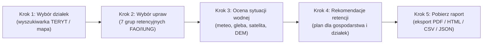

# mRolnik – „Zatrzymaj wodę, chroń plony”

**Zespół:** Koło Naukowe Zastosowań Matematyki · **Wyzwanie:** KOWR, HackNation 2026  
Prototyp aplikacji webowej (projektowany jako moduł `erolnik.gov.pl`), który zamienia otwarte dane przestrzenne, satelitarne, pogodowe, glebowe i hydrologiczne w konkretne decyzje wodne i retencyjne dla **dowolnej działki ewidencyjnej w Polsce** — bez płatnych licencji, dodatkowego sprzętu i żargonu GIS.

demo: https://youtu.be/aTPu8AybiJI

## Uruchomienie

> Projekt jest aktualnie dostępny pod linkiem:
>
> **link**:
>
> login: jury
>
> haslo: smacznejkawusi

Wymagania: **Python 3.12+**, dostęp do internetu, ~500 MB na dysku (Chrome, Edge, Firefox, Safari, Opera).

- **Windows:** pobierz repozytorium i uruchom **`mrolnik.bat`**.
- **macOS / Linux:** uruchom **`bash mrolnik.sh`** (na Debian/Ubuntu wymagane `python3-venv`).
- Skrypt tworzy `.venv`, instaluje zależności i otwiera `http://127.0.0.1:8000/web`. Zatrzymanie: `Ctrl + C`.
- **Sentinel-2 (opcjonalnie, darmowe klucze OAuth):** zarejestruj bezpłatne konto w [CDSE](https://dataspace.copernicus.eu), skopiuj `.env.example` do `.env` i uzupełnij `CDSE_CLIENT_ID` oraz `CDSE_CLIENT_SECRET` (bez kluczy warstwy satelitarne zwracają jawne *„brak danych”*).
- **Udostępnienie przez HTTPS:** `mrolnik_tunnel.bat` ([docs/TUNEL_CLOUDFLARE.md](docs/TUNEL_CLOUDFLARE.md)).

## Główne funkcjonalności

### Schemat kroków aplikacji



- **5-krokowy kreator dla dowolnej działki w Polsce** (numer TERYT lub mapa) i 7 grup retencyjnych upraw.
- **Sekwencja analityczna KOWR:** ocena sytuacji wodnej (bieżąca + tło wieloletnie) → przyczyny deficytu/nadmiaru → **retencja krajobrazowa i glebowa (priorytet)** → agrotechnika → warunkowe nawadnianie ([docs/logika_rekomendacji.md](docs/logika_rekomendacji.md)).
- **Dynamiczne obliczenia i jawna proweniencja:** każdy wskaźnik ma źródło i czas pomiaru; brak odpowiedzi API lub zachmurzenie zwraca jawne *„brak danych”*.
- **Raport końcowy:** zapis/wydruk do **PDF**, **HTML (offline)**, **CSV** i **JSON** wraz z datą, źródłami i ograniczeniami.
- **Moduły dodatkowe:** HydroMelior (wodowskazy, cieki, zastawki), historia satelitarno-klimatyczna, kalkulatory agronomiczne, filtr działek EGiB/BDOT10k.

## Architektura i technologie

- **Frontend (`static/`):** HTML5 + CSS3 + ES Modules, bez zewnętrznych CDN (`Leaflet 1.9.4` BSD-2-Clause, `Chart.js 4.4.7` MIT lokalnie w `static/vendor/`), ścisłe CSP, WCAG 2.1 AA, desktop + mobile.
- **Backend (`server.py`, `src/`):** Python 3.12+, `FastAPI` (MIT), `Uvicorn` (BSD-3), `Pydantic v2` (MIT), `requests` (Apache-2.0), `numpy` / `shapely` (BSD-3), `pyproj` (MIT), `Pillow` (MIT-CMU); równoległy orkiestrator (`src/api_service.py`), lokalny cache SQLite+JSON (`TTLCache`), tryby auth `dev`/`password`/`oidc` (gotowe pod `login.gov.pl`), CSRF i rate limiting.
- **Metody i AI:** deterministyczny silnik regułowy oparty o FAO-56 ($ET_c = K_c \cdot ET_0$, TAW/RAW), klasy glebowe IUNG-PIB (I–IV) i katalog NWRM ([docs/PODSTAWY_NAUKOWE.md](docs/PODSTAWY_NAUKOWE.md)). W działaniu aplikacji **nie używamy modeli generatywnych ani płatnych API AI**; asystenci LLM (Claude, Gemini) byli używani wyłącznie pomocniczo przy kodzie i dokumentacji.

## Źródła danych i licencje

Pełna specyfikacja w [docs/ZRODLA_DANYCH.md](docs/ZRODLA_DANYCH.md); status źródeł na żywo w zakładce **Źródła** (`/api/sources/status?check=true`).

- **Dane pobierane na żywo (live + cache TTL):**
  - *Przestrzenne:* GUGiK ULDK, EGiB WFS, BDOT10k, NMT WCS 1 m, Ortofotomapa (otwarte dane PZGiK), PRNG/Photon/Nominatim (OSM ODbL).
  - *Satelitarne:* Copernicus Sentinel-2 L2A przez CDSE (NDVI, NDMI, NDWI, maska SCL; rozp. UE 1159/2013).
  - *Meteorologiczne i glebowe:* IMGW-PIB (dane publiczne), Open-Meteo (ECMWF/ICON/GFS, ERA5-Land; CC BY 4.0 — darmowe niekomercyjnie do 10 tys. zapytań/dobę; w produkcji plan komercyjny, własna instancja AGPLv3 lub ECMWF/IMGW), zapasowo NASA POWER (domena publiczna); parametry retencyjne FAO-56 / IUNG-PIB.
  - *Hydrologiczne i statystyczne:* IMGW-PIB Hydro, BDOT10k / PGW Wody Polskie, ISOK WFS, GUS BDL (dane publiczne z atrybucją).
- **Dane referencyjne w repozytorium (`src/data/*.json`):** normy IMGW 1991–2020 (`2026-11-15`), gminy azotanowe ISAP (`2026-11-15`), jednostki TERYT PRG (`2026-11-19`), presety ULDK (`2026-11-16`), kalkulacje PODR Lubań (`2025-06-02`), tabela 7 grup upraw (FAO-56/IUNG); odświeżane skryptami w `scripts/`.

## Ograniczenia, testy i skalowalność

- **Ograniczenia:** modelowa rozdzielczość danych meteo/glebowych (2–11 km; NASA ~50 km), wymagane ≥ 70% bezchmurnych pikseli i klucze CDSE dla Sentinel-2, brak publicznego API SMSR IUNG-PIB i krajowego rejestru zastawek (przykład w Śnieciskach oznaczony `demo: true`), czynniki lokalne (drenaż, zaskorupienie) wymagają weryfikacji w polu.
- **Weryfikacja:** 327 testów `pytest` (konektory, FAO-56, kalkulatory, cache, bezpieczeństwo) + test smoke UI Playwright oraz testy krzyżowe na rzeczywistych działkach w kilku województwach:
  ```bash
  .venv\Scripts\pip install -r requirements-dev.txt
  .venv\Scripts\python -m pytest -q tests
  ```
- **Skalowalność (skala kraju):** migracja cache na Redis + PostgreSQL/PostGIS z grupowaniem zapytań meteo w siatce ~5 km (~12 tys. komórek dla Polski), harmonogramowany ingest w tle i fallback ERA5 → NASA POWER (cel ≤ 30 s cold / < 2 s warm); szacowany koszt infrastruktury: ~600–1 500 zł/mies. (pilotaż) lub ~4 000–10 000 zł/mies. (integracja ogólnopolska z eRolnik).

## Dokumentacja szczegółowa

[Architektura](docs/ARCHITEKTURA_I_DZIALANIE.md) · [Źródła danych](docs/ZRODLA_DANYCH.md) · [Podstawy naukowe](docs/PODSTAWY_NAUKOWE.md) · [Logika rekomendacji](docs/logika_rekomendacji.md) · [Bezpieczeństwo](docs/BEZPIECZENSTWO.md) · [Interfejs i testy UI](docs/GUI.md) · [Tunel Cloudflare](docs/TUNEL_CLOUDFLARE.md)

> **Zastrzeżenie:** Prototyp ma charakter informacyjno-doradczy i nie zastępuje analizy laboratoryjnej gleby, planu nawozowego, pozwolenia wodnoprawnego ani dokumentów składanych do ARiMR.
