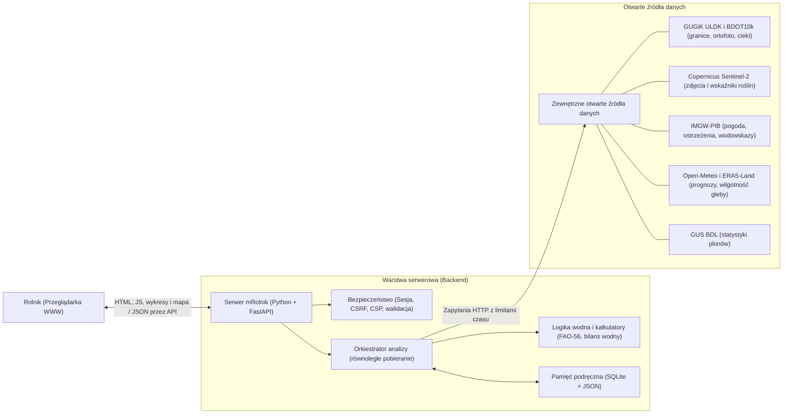
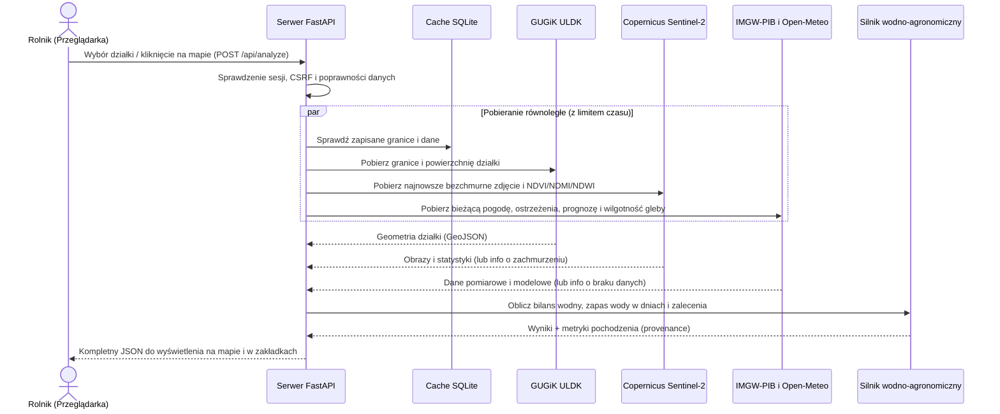
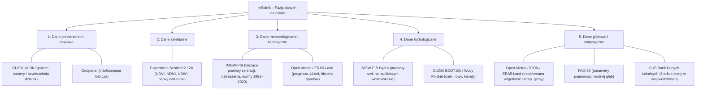

# mRolnik – wysokopoziomowy przegląd techniczny projektu

Ten dokument wyjaśnia prostym językiem, do czego służy aplikacja **mRolnik** oraz jak została zbudowana „pod maską” – od interfejsu w przeglądarce, przez serwer w Pythonie, aż po zewnętrzne źródła danych satelitarnych, pogodowych i geodezyjnych.

---

## 1. Cel projektu (w skrócie)

**mRolnik** to prototyp modułu doradczego dla rolnika (powstały w ramach zadania KOWR na HackNation, projektowany jako rozszerzenie portalu **erolnik.gov.pl**).

Jego głównym celem jest zamiana skomplikowanych, rozproszonych danych publicznych (map ewidencyjnych, zdjęć satelitarnych, pomiarów pogodowych, prognoz i danych hydrologicznych) w **konkretne, zrozumiałe wskazówki dla gospodarza** – szczególnie w zakresie **gospodarowania wodą, ochrony plonów przed suszą i planowania prac polowych**.

### Kluczowe założenia projektu
- **Zero specjalistycznego żargonu:** rolnik nie musi znać się na systemach GIS, hydrologii ani teledetekcji. Zamiast surowych skrótów dostaje jasne komunikaty (np. stan nawodnienia roślin, zapas wody w glebie w dniach, zalecenia dla zastawek na rowach).
- **Uczciwość danych:** każda liczba wyświetlana w aplikacji ma podane źródło i czas aktualizacji. Jeśli któreś zewnętrzne źródło nie odpowiada albo niebo jest zachmurzone, aplikacja pokazuje wyraźny komunikat **„brak danych”** wraz z przyczyną – nigdy nie zmyśla wartości.
- **Brak płatnych licencji po stronie użytkownika:** aplikacja korzysta z otwartych zasobów państwowych i europejskich oraz działa w zwykłej przeglądarce na komputerze i telefonie.

---

## 2. Architektura ogólna (z lotu ptaka)

System składa się z trzech głównych warstw: **przeglądarki użytkownika (Frontend)**, **lokalnego serwera aplikacji w Pythonie (Backend)** oraz **zewnętrznych baz i serwisów danych**, wspieranych przez lokalną pamięć podręczną (cache).

---

## 3. Jak przebiega analiza działki (krok po kroku)

Gdy rolnik wskaże swoją działkę na mapie lub wpisze jej numer, aplikacja nie pobiera danych po kolei (co trwałoby zbyt długo), lecz **uruchamia wiele zapytań równolegle** i składa z nich jeden spójny obraz sytuacji na polu.

---

## 4. Backend – serwer i logika obliczeniowa

Backend został napisany w języku **Python (3.12+)** w oparciu o nowoczesny framework **FastAPI** oraz serwer **Uvicorn**. Całość uruchamia się lokalnie jednym kliknięciem (`mrolnik.bat` na Windows lub `mrolnik.sh` na macOS/Linux) z pliku `server.py`.

### Główne elementy backendu

1. **Warstwa endpointów (`src/web/`)**
   Odpowiada za komunikację z przeglądarką. Każdy obszar ma własny moduł:
   - `routes_analysis.py` – główna analiza działek (`/api/analyze`), historia satelitarna, dane klimatyczne i moduł wodny/melioracyjny (`/api/hydromelior/*`),
   - `routes_water.py` – pobieranie cieków i rowów melioracyjnych dla aktualnego widoku mapy (`/api/water/features`),
   - `routes_search.py` i `routes_parcelsearch.py` – wyszukiwanie miejscowości, działek po kliknięciu na mapę oraz zaawansowane wyszukiwanie działek,
   - `routes_calc.py` – kalkulatory rolnicze (siew, nawożenie, opłacalność i optymalny plan),
   - `routes_sets.py` i `routes_auth.py` – zapisywanie zestawów działek użytkownika oraz obsługa logowania.

2. **Równoległy orkiestrator (`src/api_service.py`)**
   Zarządza wspólną pulą wątków (`ThreadPoolExecutor`). Dzięki temu pobieranie granic działki, zdjęć z satelity i prognozy pogody odbywa się jednocześnie. Jeśli jedno ze źródeł (np. zewnętrzny serwer mapowy) działa wolno lub przestanie odpowiadać, orkiestrator przerywa czekanie po określonym limicie czasu i zwraca częściowy raport z czytelną informacją o brakującym elemencie, zamiast blokować całą aplikację.

3. **Pamięć podręczna (`src/core/cache.py`)**
   Aplikacja korzysta z lekkiej bazy **SQLite** (przechowującej dane w formacie JSON z czasem wygaśnięcia TTL).
   - Granice działek (rzadko się zmieniają) są pamiętane np. przez 30 dni.
   - Zdjęcia satelitarne są pamiętane przez kilka godzin, a bieżąca pogoda przez ok. 20–30 minut.
   Dzięki temu powrót do tej samej działki jest niemal natychmiastowy, a zewnętrzne serwery publiczne nie są niepotrzebnie obciążane.

4. **Silnik wodny i agronomiczny (`src/hydromelior/` oraz `src/calculators/`)**
   - **Bilans wodny i zapas wody (`water.py`, `advisor.py`):** łączy opady z parowaniem terenowym ($ET_0$) i wylicza w oparciu o metodykę **FAO-56** ile dni zapasu wody pozostało w strefie korzeniowej dla danej gleby.
   - **Melioracja i retencja (`hydrography.py`, `network.py`, `coordination.py`, `ecoscheme.py`):** analizuje sieć cieków wokół działki, generuje ostrzeżenia i proste zalecenia dla zastawek (zamknąć / przymknąć / otworzyć) oraz podsumowuje informacje pod kątem ekoschematów.
   - **Kalkulatory (`sowing.py`, `fertilizer.py`, `profit.py`):** wykonują wszystkie obliczenia po stronie serwera (w oparciu o normy prawne, m.in. program azotanowy, oraz zalecenia ośrodków doradztwa rolniczego ODR).

5. **Bezpieczeństwo (`src/security/`)**
   - Obsługa 3 trybów uwierzytelniania: tryb lokalny `dev` (bez hasła na własnym komputerze), logowanie hasłem oraz integracja z zewnętrznym logowaniem (OIDC, np. docelowo `login.gov.pl` / SSO eRolnika).
   - Ochrona przed atakami **CSRF** (token w nagłówku), ograniczanie liczby zapytań (rate limiting) oraz ścisła walidacja wszystkich danych wejściowych za pomocą **Pydantic v2** (np. sprawdzanie, czy współrzędne leżą na terenie Polski).

---

## 5. Frontend – interfejs użytkownika

Interfejs został zbudowany w **czystym JavaScript (moduły ES)**, **HTML5** i **CSS3** – bez ciężkich frameworków (takich jak React czy Angular) i bez potrzeby budowania projektu narzędziami typu Webpack.

### Jak wygląda i działa warstwa wizualna (`static/`)
- **Brak zewnętrznych serwerów z kodem (zero CDN):** wszystkie używane biblioteki – **Leaflet** (interaktywna mapa) oraz **Chart.js** (wykresy) – znajdują się lokalnie w folderze `static/vendor/`. Gwarantuje to szybkość, prywatność i spełnienie restrykcyjnej polityki bezpieczeństwa (**CSP** – brak skryptów wstrzykiwanych w HTML).
- **Mapa na pierwszym planie (`static/js/map.js`):** użytkownik widzi granice swoich działek na tle ortofotomapy GUGiK lub mapy OpenStreetMap. Może jednym kliknięciem przełączać warstwy:
  - *Kondycja roślin (NDVI)* – zieleń i gęstość łanu,
  - *Woda w roślinach (NDMI)* – uwodnienie roślin i wierzchniej warstwy,
  - *Woda na polu (NDWI)* – wykrywanie zastoisk i podtopień,
  - *Cieki i rowy (BDOT10k)* – sieć wodna w okolicy działki.
- **Panel z zakładkami (`static/index.html` + `static/js/views/`):**
  1. **Główna** – podsumowanie „Dziś na polu” (proste komunikaty i ostrzeżenia) oraz karty wybranych działek.
  2. **Historia** – wielomiesięczne zmiany wskaźników satelitarnych i animacja zmian na polu.
  3. **Woda** – wykres bilansu wodnego (opad vs parowanie), wskaźnik wilgotności gleby, najbliższy wodowskaz IMGW i zalecenia retencyjne (np. sterowanie zastawkami).
  4. **Plony** – odniesienie do statystyk plonowania (GUS) i cen.
  5. **Klimat** – wieloletnie normy klimatyczne i trendy dla lokalizacji pola.
  6. **Kalkulatory** – interaktywne narzędzia dla siewu, nawożenia i opłacalności upraw.
  7. **Źródła** – przejrzysty status wszystkich podłączonych baz danych (czy działają w danej chwili) wraz z informacją o licencjach.
- **Dostępność i responsywność:** układ dopasowuje się automatycznie do ekranu komputera oraz telefonu (na smartfonie panel wysuwa się pod mapą), wspiera tryb jasny i ciemny oraz czytniki ekranu (standard WCAG 2.1 AA).

---

## 6. Źródła danych (skąd pochodzą informacje)

Projekt łączy dane z **5 głównych obszarów**, wykorzystując wyłącznie legalne, otwarte źródła publiczne i naukowe:

> **Ważna uwaga techniczna:** aplikacja wyraźnie rozróżnia w interfejsie **pomiar** (np. odczyt ze stacji IMGW, zdjęcie z satelity) od **modelu / prognozy** (np. wyliczona wilgotność gleby w siatce kilku kilometrów) oraz **danych demonstracyjnych** (np. przykładowa sieć zastawek).

---

## 7. Mapa najważniejszych plików w repozytorium

Dla osób chcących zajrzeć bezpośrednio do kodu, struktura projektu jest podzielona według ról:

| Ścieżka | Za co odpowiada |
|---|---|
| `server.py` | Główny punkt uruchomienia serwera FastAPI i podpięcia modułów. |
| `mrolnik.bat` / `mrolnik.sh` | Skrypty startowe dla użytkownika końcowego (tworzą środowisko i otwierają przeglądarkę). |
| `src/api_service.py` | Orkiestracja równoległego pobierania danych i łączenia wyników dla listy działek. |
| `src/web/` | Definicje adresów API (`/api/*`, `/auth/*`) i walidacja zapytań. |
| `src/data/` | Konektory do zewnętrznych źródeł (ULDK, Sentinel-2, IMGW, Open-Meteo, BDOT10k, GUS). |
| `src/hydromelior/` | Logika bilansu wodnego, analizy cieków, zaleceń melioracyjnych i ekoschematów. |
| `src/calculators/` | Silnik kalkulatorów agronomicznych (siew, nawożenie, opłacalność). |
| `src/core/` | Konfiguracja aplikacji (`config.py`) i pamięć podręczna SQLite (`cache.py`). |
| `src/security/` | Logowanie, sesje, tokeny CSRF, nagłówki bezpieczeństwa CSP i limity zapytań. |
| `static/` | Cały interfejs użytkownika (HTML, CSS, czysty JS, lokalne biblioteki Leaflet i Chart.js). |
| `docs/` | Dokumentacja techniczna, kontrakty między modułami, opis źródeł i bezpieczeństwa. |
| `tests/` | Testy automatyczne backendu (`pytest`) oraz test interfejsu w przeglądarce (`Playwright`). |
